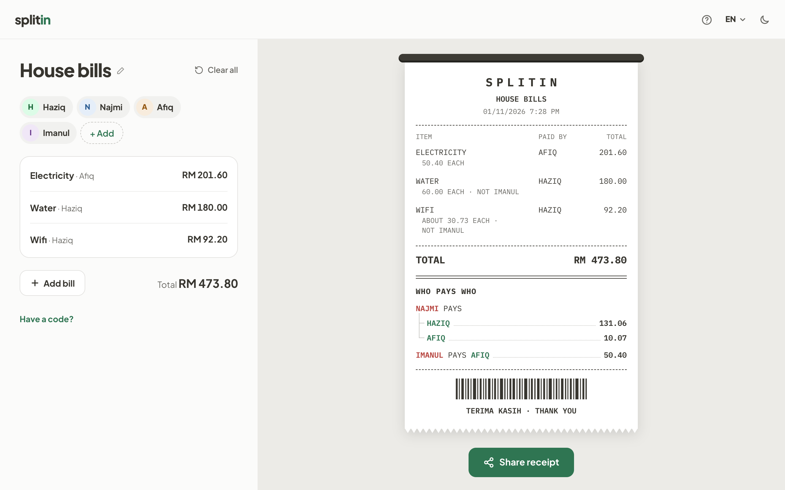
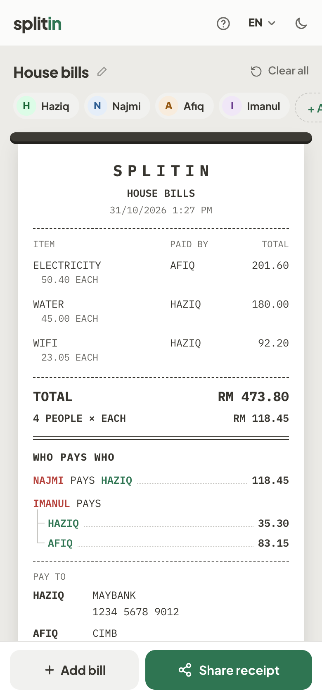
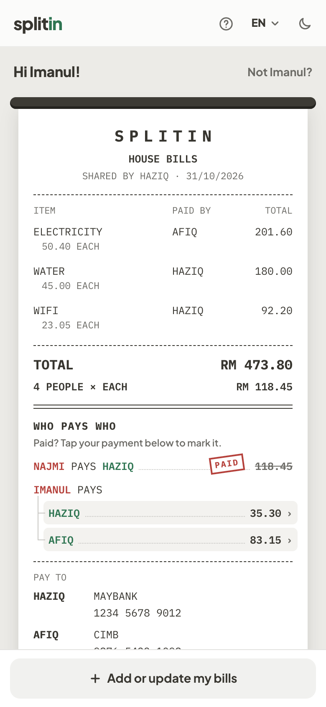
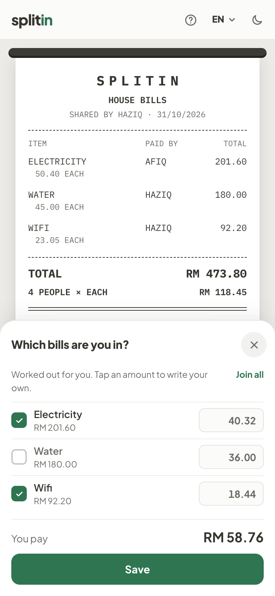
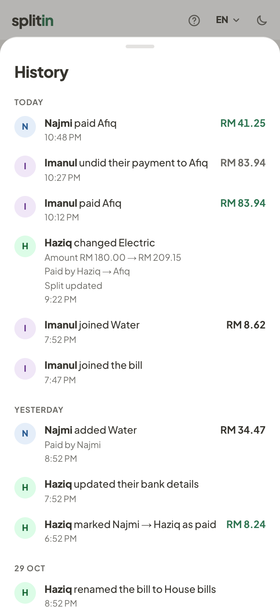

# Splitin

Split shared bills with anyone. Name the bill, add the people and who paid what, and Splitin works out who pays who with the fewest payments. Share it as a receipt picture and a link. Nobody signs up or installs anything.

|                                                Add people and bills                                                 |                                          Everyone opens the link                                          |                                                              Others join the bills they're in                                                               |                                             Everyone sees every change                                             |
| :-----------------------------------------------------------------------------------------------------------------: | :-------------------------------------------------------------------------------------------------------: | :---------------------------------------------------------------------------------------------------------------------------------------------------------: | :----------------------------------------------------------------------------------------------------------------: |
|  |  |  |  |

## What it does

- **Several bills, different payers.** For example, Afiq paid the electricity and Haziq paid the water and wifi.
- **Equal split by default.** Change one person's amount and the rest re-splits, or leave someone out of a bill.
- **SST and service charge.** Tick them on a bill and type prices before them. Each person pays what they had plus their part of the service charge; SST is split equally.
- **Scan a receipt.** Take a photo and Splitin fills in the shop, prices, discounts, service charge, SST and total. Name it, pick who paid and check the total paid (type over it to change it, like after a ShopeePay deal); below, tap each item and pick who had it (every name for a shared item), or use ‹ › to move along. Print it points to anything still missing. SST and service charge show on their own line, named as on the receipt. An item's discount goes only to whoever had it; SST (even SST already inside the prices, which is shown on its own while the items keep their printed prices) is split equally between everyone who had something, and Each person pays shows each person's food plus their tax; a whole-bill discount, service charge and paying less are shared by what each person had. One receipt per bill. Tap the bill later to change who had what. The photo goes to Google's AI to be read. Once the bill is shared, everyone with the link can tap the bill to see the receipt photo, and it's deleted with the bill after 30 days.
- **Share to the group.** One Share button sends a receipt picture, a link and a short code to any app on your phone. Nothing is saved online until you share. Then the bill page opens, and every later change happens there.
- **Everyone uses the link or code.** They pick their name, see who to pay, and tap their payment once they've paid. The person getting paid can mark it too.
- **Pay by QR or bank details.** Anyone can add their account or payment QR to their name (☰ then People, or People by the bill name on a computer), and whoever shares is asked for theirs before the link goes out. Others can save the QR or copy the account number, then pay in their own bank app. Splitin warns them if the QR's name doesn't match, and never moves any money.
- **Anyone on the bill can add to it.** They can add a bill they paid, join the bills they're in, change their part, fix the spelling of their name, or add their own name if it's missing.
- **The owner stays in control.** The owner can edit any bill, add, rename or remove people, mark any payment, lock the bill, and use a private link to edit from a new phone. If that link gets out, they can make a new one and the old one stops working.
- **History.** Everyone with the link can see every change, with the name and time.
- **See how it's worked out.** Calculation goes through the bills one by one with arrows for who owes who, cancels out debts that go both ways, then shows the fewest payments.
- **Links delete themselves** 30 days after they are created.
- **One button for everything on phones.** ☰ at the bottom right opens a short menu, and each item slides up from the bottom. ‹ goes back to the menu, and ✕ or a swipe down closes it.
- **English, Bahasa Melayu, Mandarin (中文) and Tamil (தமிழ்)**, light, dark or automatic look, and a built-in guide.

Amounts are in Malaysian Ringgit (RM) only.

## Next MVP

- **Past splits.** See your past splits and duplicate one for next month.
- **Paid plans.** Links that last longer, and past splits on every device. People opening a link never pay or sign up.

## Tests

- `pnpm test` runs the unit tests.
- `pnpm test:e2e` runs the browser tests against a real database on your own computer, so it never touches live data. Open OrbStack or Docker and run `supabase start` first.
