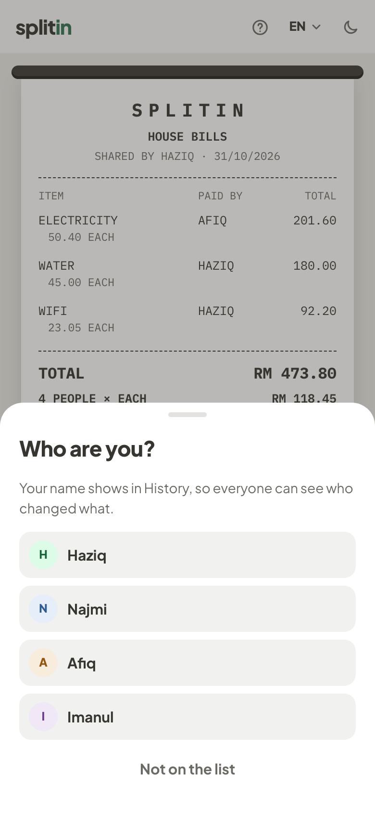

# Splitin

Split shared bills with friends or family. Add the people, add the bills and who paid each one, and Splitin works out who owes whom with the fewest payments. Share the result as a receipt picture and a link. Nobody signs up or installs anything.

|                                                 Add people and bills                                                 |                                           Friends open the link                                           |                                             They tap their name once                                             |                                             Everyone sees every change                                             |
| :------------------------------------------------------------------------------------------------------------------: | :-------------------------------------------------------------------------------------------------------: | :--------------------------------------------------------------------------------------------------------------: | :----------------------------------------------------------------------------------------------------------------: |
|  |  |  |  |

Planned work is in [TODO.md](TODO.md).

## What it does

- **Opens straight into the tool.** No landing page and no login.
- **Several bills, different payers.** For example, Afiq paid the electricity and Haziq paid the water and wifi.
- **Equal split by default.** You can type a different amount for one person and the rest re-splits, or leave someone out of a bill.
- **Receipt-style summary.** Each person's share, who owes and who collects, and the smallest set of payments that settles everything.
- **Share to the group.** A picture of the receipt plus a link, sent through WhatsApp or the phone's share menu.
- **Friends use the link.** It opens straight on the receipt: who pays who, the bank account numbers, and PAID stamps as payments come in. Someone who has paid taps their payment on the receipt and confirms, one payment at a time. The person who shared sees who marked what and can mark any payment unpaid again. The person who shared can also mark payments and send reminders.
- **Friends can add what they paid.** They add a bill from the link, and can delete only what they added, on the same phone. The first time they add, delete or mark something, they tap their name from the bill.
- **History.** Everyone with the link can see every change, with the name and time: bills added, changed or deleted, people and bank details updated, payments marked or undone. Names are not verified, because there is no login.
- **Links delete themselves** 30 days after they are created.
- **English and Bahasa Melayu**, dark and light mode. New visitors get English and light mode.
- **Phone and desktop layouts**, plus a built-in "How to use Splitin" guide with small try-it demos.

Amounts are in Malaysian Ringgit (RM) only.

## How it works

**Drafts stay on the device.** While you add people and bills, everything is saved in the browser's `localStorage` (`splitin:draft:v2`). Nothing reaches the server until you tap "Share receipt".

**Sharing creates a link.** "Share receipt" saves the bill to the `bills` table and returns a random id, so the link is `/bill/<id>`. The browser that shared it also gets a secret owner token (`splitin:owner:<id>`); only its hash is stored in the database. Whoever holds the token can edit the bill and mark or undo any payment. Anyone else can only mark a payment that is still open, for its exact amount, and undo a mark made from the link within 15 minutes.

**Friends' bills.** A friend's bill is saved in the same `doc`. The server gives the friend's browser a secret key (`splitin:mine:<id>`) and stores only its hash on the item, and that key is the only way for a friend to delete it. If the owner edits the item, the key stops working.

**History.** Each change adds a row to the `bill_events` table. A friend's name comes from the person they picked (`splitin:me:<id>`), which the server looks up on the bill, so it can't be made-up text. Bank account numbers are never recorded. If history can't be read or written, the bill keeps working.

**Money is whole sen.** All amounts are integers, so nothing is lost to decimals. When an amount does not divide evenly, the leftover sen go to the first people in the list: RM 240.90 between four people is 60.23, 60.23, 60.22 and 60.22. The maths is in [src/lib/money](src/lib/money) and [src/lib/bill.ts](src/lib/bill.ts).

**Live updates.** After a change, the server sends a small "changed" signal on the Supabase Realtime channel `bill:<id>`. It carries no data. Open pages hear it and reload their data from the server.

**Automatic deletion.** A shared bill stops loading 30 days after it was created, and a daily database job deletes it, together with its payments and history.

**Access control.** Row-level security is on for every table with no policies, so the public key cannot read or write anything. Only server code, using the service-role key, touches the tables. Sharing is limited to 30 new bills per hour per IP address.

**Receipt picture.** The receipt is drawn in the page and captured as a PNG in the browser. On phones it goes to the system share menu with the message. On computers it is copied to the clipboard and WhatsApp opens with the message and link.
